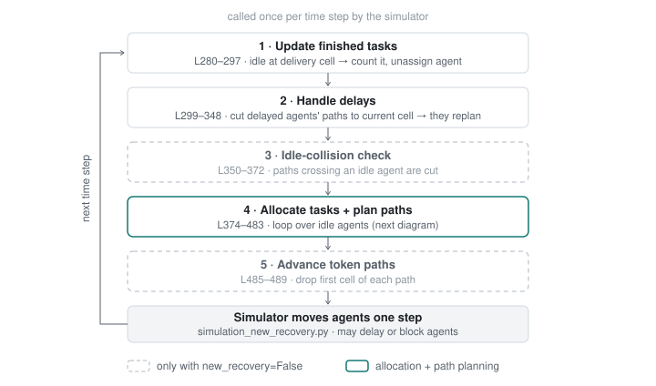
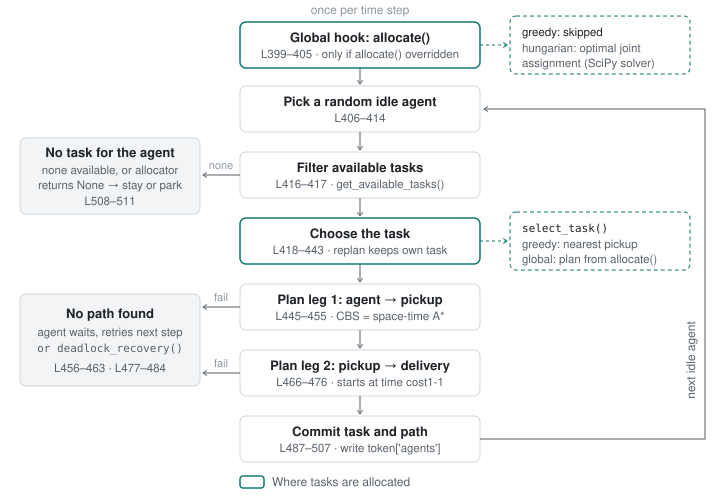

# Multi-Agent Pickup and Delivery
<p align="justify">
This repo contains implementations of various algorithms used to solve the problem of Multi-Agent Pickup and Delivery (a generalization of Multi-Agent Path Finding) and a simulation envirionment used to test them.
</p>

## Overview
<div align="justify">
Multi-Agent Pickup and Delivery (MAPD) is the problem of computing collision-free paths for a group of agents such that they can safely reach delivery locations from pickup ones.  These locations are provided at runtime, making MAPD a combination between classical Multi-Agent Path Finding (MAPF) and online task assignment. Current algorithms for MAPD do not consider many of the practical issues encountered in real applications: real agents often do not follow the planned paths perfectly, and may be subject to delays and failures.  The objectives of this work are to study the problem of MAPD with delays, and to present solution approaches that provide robustness guarantees by planning paths that limit the effects of imperfect execution. In particular, two  algorithms are introduced, k-TP and p-TP, both based on a decentralized algorithm typically used to solve MAPD, Token Passing  (TP), which offer deterministic and probabilistic guarantees,respectively. Experimentally, these algorithms are compared against a version of TP enriched with recovery routines. k-TP and p-TP, planning robustsolutions, are able to significantly reduce the number of replans caused by delays, with little or no increase in solution cost and running time.


## Simulation
In the image we can see an overview of the simulation pipeline. 
<p align="center">
    
</p>
<p align="justify">
Green rectangles represents the input (a yaml file containing information about the environment, agents, tasks, delays) and the output (a json file containing the actual path walked by the agents) of the simulation. Blue rectangles constitute the core components of the simulation. The orange rectangular outline symbolizes the loop performed by advancing the simulation of one time step until all the tasks are completed. At every time step, the simulation manager calls the high level algorithm (k-TP or p-TP) to plan paths for the agents to complete available tasks; after the high level algorithm return the paths, agents are advanced of one step along their paths or remain in the current location depending on whether they are delayed at that time step or not. Also agents that would cause collisions by moving are stopped. Information about these delayed agents is given to the high level algorithm at the next time step. Finally, the purple rectangular outline represents the loop performed at any time step on all the agents that can be assigned to a task or that need a replan. When one of these agents is selected, he is assigned to the closest task according to Manhattan distance (in case of a replan task assignment is already done) and then the low level algorithm (in the code we can see two algorithms called, CBS and state-space A*, but in practice only state-space A* is used) is called to compute a path from the start location of the agent to the pickup vertex of task (in case of a replan, if an agent has already reached the pickup vertex this first path is empty) and then a path from the the pickup vertex to the goal vertex of the task.
</p>

## Requirements
The code has been tested with Python version 3.6.9.
All the packages needed to run the code can be found in the file `requirements.txt`. To install all the requirements, run the following command:

```
pip install -r requirements.txt
```

## Run One Simulation
Before running the simulation, an environment can be chosen. The <i>Environments</i> folder contains different predefined environments. There exists two main types of environments, differentiated by the presence or absence of the sub-string <i>_random</i> in the name. The ''random'' environments just specify the number of tasks and delay per agents, while the others present fixed tasks and delays (to use these environments, a special simulation parameter must be set). To change the simulation environment, open the file `config.json` and modify the parameter <i>''input_name''</i> with the file name of the desired environment.
Then, to start the simulation, the script `demo.py` can be run. The script accepts various command line arguments:
 <ul>
    <li> <i>-k</i>: an integer (k >= 0) which represents the robustness parameter for k-TP; </li>
    <li> <i>-p</i>: a float (0 <= p <= 1) which represents the robustness parameter (probability threshold) for p-TP; </li>
    <li> <i>-pd</i>: a float (0 <= pd <= 1, default .02) which represents the expected probability of an agent of being delayed at any time step (used in p-TP); </li>
    <li> <i>-p_iter</i>: an integer (p_iter >= 1, default 1) which represents the number of times a new path can be recalculated if the one calculated before exceeds the probability threshold (used in p-TP); </li>
    <li> <i>-a_star_max_iter</i>: an integer (a_star_max_iter >= 1, default 5000) which represents the maximum number of states explored by the low-level algorithm state-space A*; </li>
    <li> <i>-slow_factor</i>: an integer (slow_factor >= 1, default 1) which allows to slow down the visualization; </li>
    <li> <i>-not_rand</i>: this parameter needs to be present if the input environment is not randomized; </li>
    <li> <i>-task_allocation</i>: the name of the task allocation algorithm to use. Available: <i>greedy</i> (default, the original closest-pickup rule of Token Passing) and <i>hungarian</i> (optimal joint assignment of the idle agents to the open tasks with the Hungarian method). The available names are also listed by <code>python3 demo.py -h</code>. </li>
</ul>
Note that if the script is run without both k and p, it becomes TP with recovery routines. If the visualization does not start after the end of the simulation, the error could be related to the non-GUI back-end of Matplotlib. To resolve this problem, restart the simulation after the following command has been run:
<p></p> 
    
```
sudo apt-get install python3-tk
```

In the following we present some example runs.<br>
Run TP with recovery routines:

```
python3 demo.py
```

Run k-TP with k = 2 and slower visualization:

```
python3 demo.py -k 2 -slow_factor 3
```

Run p-TP with p = 0.6, pd = 0.05 in a non-randomized environment:

```
python3 demo.py -p 0.6 -pd 0.05 -not_rand
```

Run with the Hungarian method as task allocation algorithm:

```
python3 demo.py -task_allocation hungarian
```

## Add a Task Allocation Algorithm
Task allocation algorithms live in the <i>Simulation/TaskAllocation</i> package. At every time step, <code>TokenPassingRecovery.time_forward()</code> calls the selected allocator in two places:
<ul>
    <li> <code>allocate(agents, tasks)</code>: global hook, called once before the loop over the idle agents, with all the idle agents that have no task and all the tasks not assigned yet. It is called only if the allocator overrides it (see <code>has_global_step()</code>), so local allocators such as greedy skip it entirely; </li>
    <li> <code>select_task(agent_name, agent_pos, available_tasks)</code>: called inside the loop for every idle agent without a task; it returns the name of the chosen task, or <code>None</code> to leave the agent without a task in this time step. After path planning, <code>task_assigned()</code> or <code>planning_failed()</code> tells the allocator how it went. </li>
</ul>
To add an algorithm:
<ol>
    <li> create a new file in <i>Simulation/TaskAllocation</i> with a subclass of <code>TaskAllocator</code> (see <code>base.py</code>) and give it a <code>name</code>:
        <ul>
            <li> for a local algorithm, which chooses the task of one agent at a time, implement <code>select_task()</code> (example: <code>GreedyAllocator</code> in <code>greedy.py</code>); </li>
            <li> for a global algorithm, which assigns all the idle agents at once, subclass <code>GlobalTaskAllocator</code> and implement <code>compute_assignment(agents, tasks)</code>, returning a dictionary <code>{agent_name: task_name}</code> (example: <code>HungarianAllocator</code> in <code>hungarian.py</code>). The agent loop then plans the paths following that assignment; if the task reserved for an agent is no longer available when the agent is handled, or no path to it is found, the agent falls back to the closest task not reserved for another agent, and the assignment is recomputed at the next time step. </li>
        </ul>
        Through <code>self.tp</code> the allocator can read the whole state of <code>TokenPassingRecovery</code> (token, other agents' paths, simulation time, <code>get_available_tasks(agent_pos)</code>); </li>
    <li> register the class in the <code>ALLOCATORS</code> dictionary in <code>Simulation/TaskAllocation/__init__.py</code>; </li>
    <li> run it with <code>python3 demo.py -task_allocation &lt;name&gt;</code>, or set <code>args['task_allocation']</code> in the experiments run by <code>Utils/stats.py</code>. </li>
</ol>
The Hungarian allocator solves the assignment problem with <code>scipy.optimize.linear_sum_assignment</code>, which returns an optimal assignment (internally SciPy uses a modified Jonker-Volgenant algorithm, which reaches the same minimum total cost as the textbook Hungarian method). It minimizes the sum of the Manhattan distances between the agents and the pickup cells of their tasks (override <code>cost()</code> to change it); agent-task pairs where the task is not available for the agent are forbidden. If there are more agents than tasks some agents get no task, and if there are more tasks than agents the cheapest set of tasks is chosen.

## Run Multiple Experiments
To run multiple experiments and collect all the statistics, a specific script, `run_all_experiments_new.py`, can be used. This script contains a list of experiments (easy to modify and extend) that will be run exploiting multi-threading; after all the experiments terminate a json file with the results will be saved in the <i>Experiments</i> folder. The script can be run with the following command:

```
python3 -m Utils.run_all_experiments_new
```
To see the results plotted as box plots, the script `plot_experiments.py` can be used. First, modify the file `config.json` changing the parameter <i>''experiments_name''</i> with the name of the experiments file that has just been created. Then run the visualization tool with the following command:

```
python3 -m Utils.plot_experiments
```

When a plot is closed, the next one will appear until the end of the experiments.


## Code Flow of the High Level Algorithm
The high level algorithm is implemented by the class `TokenPassingRecovery` in `Simulation/TP_with_recovery.py`. Task allocation and path planning are not separate modules: both happen inside its `time_forward()` method, which the simulator calls once per time step. The line numbers in the diagrams refer to `Simulation/TP_with_recovery.py`.

<p align="center">
    
</p>

<p align="justify">
At every time step <code>time_forward()</code> runs five phases in order. First, agents that are idle on the delivery cell of their task have that task marked as completed and are unassigned (phase 1). Then agents that were delayed, or blocked because of a delay, have their planned path truncated to their current cell, so that they become idle and get replanned (phase 2). Phases 3 and 5 only run when <code>new_recovery=False</code> (<code>demo.py</code> uses <code>True</code>): phase 3 cuts paths that would cross an idle agent, and phase 5 advances the paths stored in the token, a job otherwise done by the simulator. Phase 4 is where tasks are allocated and paths are planned: first the global allocation hook of the selected allocator runs once, then the idle agents are handled one at a time. After <code>time_forward()</code> returns, the simulator moves every agent one cell along its path, unless it is delayed or blocked, and the next time step starts.
</p>

<p align="center">
    
    <br/>
    <i>Zoom into phase 4 of the previous diagram: the allocation and path-planning loop executed for every idle agent.</i>
</p>

<p align="justify">
Before the loop, the global hook <code>allocate()</code> of the selected allocator can compute a joint assignment of all the idle agents to the open tasks (the Hungarian allocator does; for the greedy one the hook is skipped). Then, following Token Passing, idle agents are handled one at a time in random order. For the selected agent, the available tasks are those whose pickup and delivery cells are not the end of another agent's path nor the delivery cell of an already assigned task. If there is none, the agent stays where it is or, if it is standing on a task cell, moves to the closest free non-task endpoint. Otherwise a task is chosen: an agent that is being replanned after a delay keeps its own task, while a free agent gets the task returned by <code>select_task()</code> of the selected allocator: with greedy, the task with the closest pickup cell according to the Manhattan distance; with a global allocator, the task reserved for it by <code>allocate()</code>. If <code>select_task()</code> returns <code>None</code>, the agent is treated as if no task were available. The path is then planned in two legs with state-space A*, from the agent to the pickup cell and from the pickup cell to the delivery cell, treating the other agents as moving and static obstacles; the second leg starts at the time the agent reaches the pickup cell. If either leg has no solution, the allocator is notified with <code>planning_failed()</code> and the agent waits and retries at the next time step, or <code>deadlock_recovery()</code> is called. Only when both legs are found is the task assigned and the full path written into the token, after which the next idle agent is handled.
</p>
